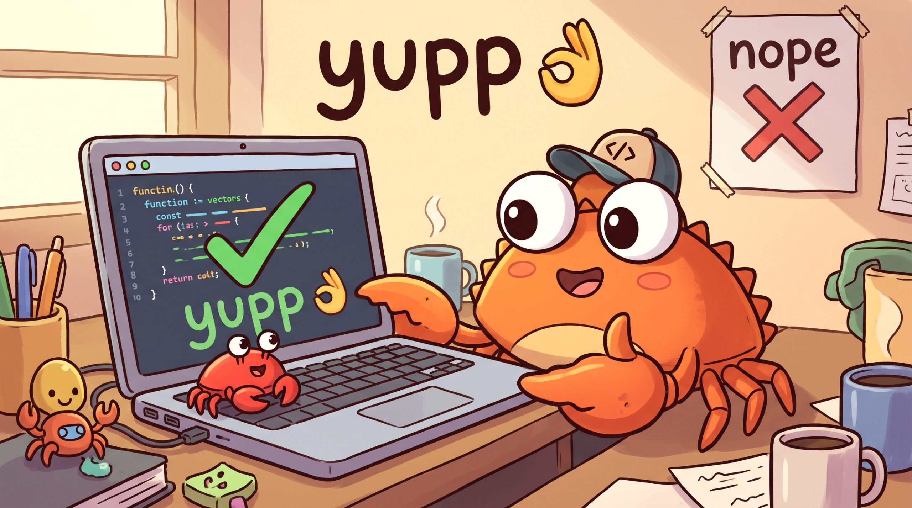

<p align="center">
  
</p>

# yupp 👌

**0-LLM Rust CLI & MCP gatekeeper** that catches AI **test theater**, **placeholder/stub slop**, **leaked secrets**, and **untested blast radius** in milliseconds.

Works alongside **Claude Code, Cursor, Codex, Aider**, or any human PR. No API keys, no cloud uploads, no login — pure local Tree-sitter AST analysis across **Python, TypeScript/JavaScript, Rust, and Go**.

---

## 3-State Verdict

### `yupp 👌` — Clean (exit `0`)
```text
yupp v0.1.1 · scanned 1 files (+3 -0) in 6ms (0-LLM · Tree-sitter AST)

yupp 👌  (0 blockers, 0 warnings · 6ms)
```

### `hmm 🤔` — Warnings only, no blockers (exit `0`, or exit `1` with `--strict`)
```text
yupp v0.1.1 · scanned 2 files (+14 -1) in 9ms (0-LLM · Tree-sitter AST)

[BLAST RADIUS] 1 modified symbol(s) with cross-file callers
  • src/billing.py:calculate_discount (2 callers) [NO TEST CALLER]
    ↳ src/checkout.py, src/invoice.py

[SILENT SLOP & HAZARDS] 2 finding(s)
  1. src/parse.rs:2       New .unwrap()/.expect() panic hazard introduced [slop/rust-unwrap]
  2. src/billing.py:11    Empty catch/except block silently swallows errors [slop/empty-catch]

hmm 🤔  (0 blockers, 2 warnings · 9ms)
```

### `nope ❌` — Blockers detected (exit `1`)
```text
yupp v0.1.1 · scanned 2 files (+9 -4) in 11ms (0-LLM · Tree-sitter AST)

[TEST THEATER] 2 finding(s)
  1. tests/test_auth.py:1   Test assertions reduced (-2 removed, +0 added) [test-theater/assertions-removed]
  2. tests/test_auth.py:8   Test `test_verify_token` mocks modified target without behavioral assertions [test-theater/mock-testing-mock]

[SECRET LEAK] 1 blocker(s)
  1. src/config.rs:14       Hardcoded secret/credential pattern introduced [secret/stripe]

nope ❌  (3 blockers, 0 warnings · 11ms · exit 1)
```

*(Need plain ASCII or uncolored CI logs? ANSI colors automatically disable on non-TTY pipes or `NO_COLOR=1`, or pass `--no-color` / `--color always|auto|never` and `--no-emoji` → `yupp [OK]` / `hmm [WARN]` / `nope [FAIL]`.)*

---

## Quick Start

```bash
# 1-line install (Linux x86_64, macOS arm64/x86_64 · verifies SHA-256)
curl -fsSL https://raw.githubusercontent.com/daffa2555/yupppp/main/install.sh | sh

# Or install from crates.io via Cargo
cargo install yupp

# Scan branch diff before opening a PR
yupp main..HEAD

# Scan staged changes before committing
yupp --staged

# Pipe any unified diff
git diff main..HEAD | yupp --stdin

# Generate .yupp.toml + optional git hook
yupp init --hook pre-push
```

### Output Formats

```bash
yupp main..HEAD --format terminal     # default human-readable output
yupp main..HEAD --format pr-comment   # compact Markdown table for GitHub PRs
yupp main..HEAD --format sarif        # SARIF 2.1.0 for GitHub Code Scanning
yupp main..HEAD --format json         # structured JSON with verdict ("yupp" | "hmm" | "nope")
```

---

## Native MCP Mode (`yupp mcp`)

Plug `yupp` directly into **Claude Code, Cursor, or Codex** over JSON-RPC 2.0 stdio so your agent verifies its own diff *before* saying "done":

```json
{
  "mcpServers": {
    "yupp": {
      "command": "yupp",
      "args": ["mcp"]
    }
  }
}
```

Exposed MCP tools:
- `yupp_scan_diff` — scan git diff range, staged changes, working tree, or raw unified diff
- `yupp_check_file` — run AST, test-theater, slop, and secret checks on a single file
- `yupp_blast_radius` — map cross-file callers and test coverage for a symbol

---

## What `yupp` Catches

- **Deep Test Theater (Blockers):**
  - Removed/weakened assertions (`test-theater/assertions-removed`)
  - Empty test functions with 0 assertions (`test-theater/empty-test`)
  - Tautology assertions like `assert True` / `expect(true).toBe(true)` (`test-theater/trivial-assertion`)
  - Added `.skip`, `xit`, `@pytest.mark.skip`, `#[ignore]`, `t.Skip()` (`test-theater/skipped-test`)
  - **Diff-aware mock-testing-mock** (`test-theater/mock-testing-mock`): flags tests that mock the exact symbol/module changed in the diff with only mock-call assertions (designed to avoid flagging legitimate dependency injection mocks)
  - Newly added public/exported functions with 0 test references (`test-theater/untested-new-api`)
- **AI-Specific Slop & Escape Hatches (Warnings):**
  - Stub/placeholder functions (`pass`, `...`, `todo!()`, `unimplemented!()`, `// implement logic here`)
  - Duplicate AST structural blocks introduced in the same PR
  - Silent error-swallowing catches (`except Exception: return None`, `catch (e) {}`)
  - Type-checker suppressions (`@ts-ignore`, `# type: ignore`, `#[allow(warnings)]`) and new Rust `.unwrap()`/`.expect()`
- **Conservative Breaking Signature & Blast Radius (Warnings):**
  - Compares old base AST vs new AST to surface breaking signature changes and unupdated cross-file callers while filtering generic method names (`init`, `save`, `run`, `get`, `set`, `parse`, etc.) to minimize noise.
- **Secret Leaks (Blockers):**
  - AWS keys, Stripe keys, GitHub PATs, JWTs, and database connection URIs.

---

## Configuration (`.yupp.toml`)

Run `yupp init` to create `.yupp.toml`:

```toml
ignore = ["**/generated/**", "vendor/**"]
disable = ["slop/debug-leftover"]

[severity]
"slop/rust-unwrap" = "warning"
"breaking/signature-changed" = "warning"
```

## GitHub Actions

See [examples/github-action.yml](examples/github-action.yml) for a drop-in PR comment & blocker workflow.

## License

[MIT](LICENSE)

---

*Built for fun to keep AI coding agents honest on local diffs (v0.1.1 — feedback and edge cases welcome).*
